<div align="center">


# Forninho da Lili

**Site e painel administrativo para uma confeitaria artesanal de doces sob encomenda.**

O cliente encontra os doces e encomenda pelo WhatsApp em um toque.<br>
A Lili cuida de produtos, pedidos e clientes sozinha, sem mexer em código.


[Como rodar](#-como-rodar) · [Funcionalidades](#-funcionalidades) · [Painel da Lili](#-painel-administrativo) · [Próximos passos](#-próximos-passos)

</div>

<br>

<p align="center">
  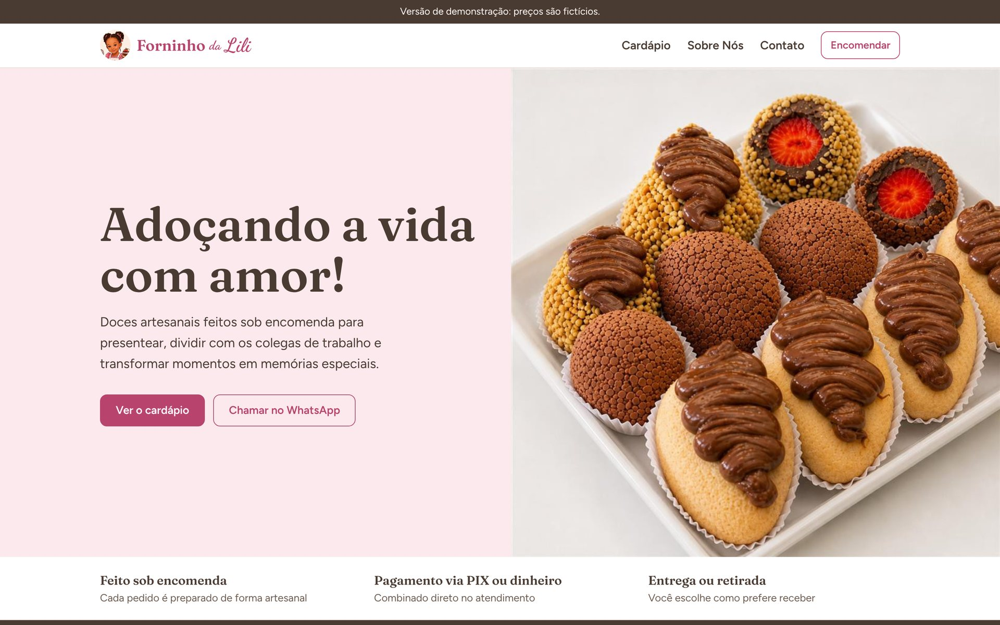
</p>

## 📖 Sobre o projeto

O **Forninho da Lili** é uma confeitaria artesanal: coxinhas de morango, cookies e kits de presente, tudo feito sob encomenda e combinado pelo WhatsApp.

O projeto começou como uma landing page de uma página só e foi reorganizado como um site profissional, em duas partes que conversam entre si:

| | Para quem | O que faz |
|---|---|---|
| 🍰 **A vitrine** | Clientes | Mostra o cardápio, explica como encomendar e leva direto ao WhatsApp com a mensagem pronta |
| 🔐 **Os bastidores** | Só a Lili | Painel com login para cadastrar doces, registrar pedidos e acompanhar as vendas |

O que a Lili muda no painel aparece no site na hora.

## ✨ Funcionalidades

### Site do cliente

- **Páginas separadas**: Início, Cardápio, Sobre Nós e Contato, com menu e rodapé iguais em todas
- **Vitrine animada**: ao rolar a página, os doces se revezam um por vez, como numa vitrine de confeitaria
- **Cardápio com filtros** por categoria (Docinhos, Cookies, Kits e presentes)
- **Aviso para alérgicos** em cada doce
- **Encomenda em um toque**: o botão abre o WhatsApp já com o nome do doce escrito
- **"Foto em breve"** para doces sem foto e **"Sob consulta"** para itens sem preço fixo
- **Pensado primeiro para o celular**, com botões grandes e cardápio em lista
- **Acessível**: navegação por teclado, textos alternativos nas imagens e animações que respeitam quem pediu menos movimento no sistema
- **Funciona sem internet** para as fontes e imagens (tudo está no projeto)

<p align="center">
  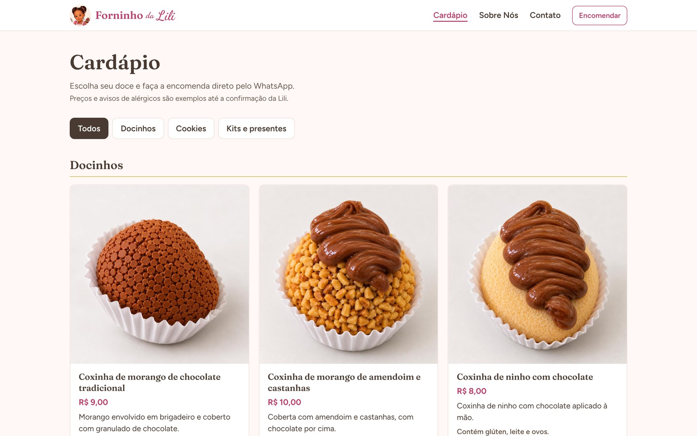
  &nbsp;
  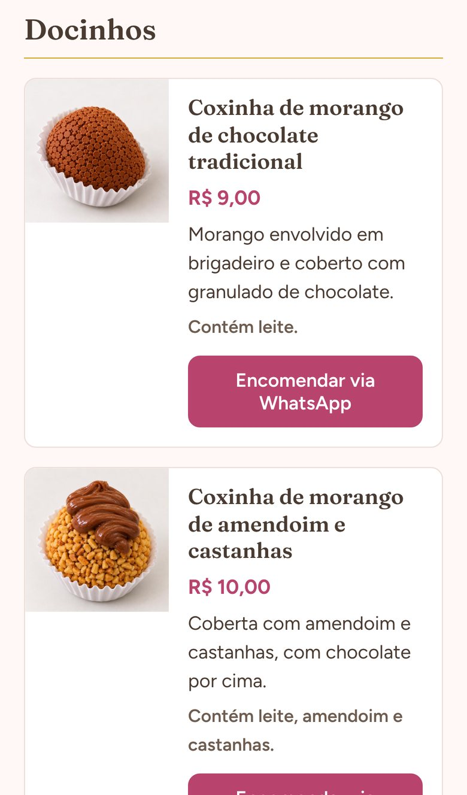
</p>

### 🔐 Painel administrativo

O painel **não tem nenhum link no site**. Ele só abre digitando o endereço com `/admin` no final, e pede usuário e senha.

| Tela | O que a Lili faz |
|---|---|
| **Login** | Entra com usuário e senha. Sem login, qualquer página do painel volta para cá |
| **Visão geral** | Vê pedidos, itens vendidos e faturamento do mês, pedidos recentes e o que mais vende |
| **Produtos** | Cadastra, edita, desativa e exclui doces, com envio de foto pelo celular |
| **Pedidos** | Registra encomendas com vários itens, muda a situação (Novo → Em preparo → Pronto → Entregue) e vê o total |
| **Clientes** | Guarda quem já comprou, com atalho para o WhatsApp e para um novo pedido |

<p align="center">
  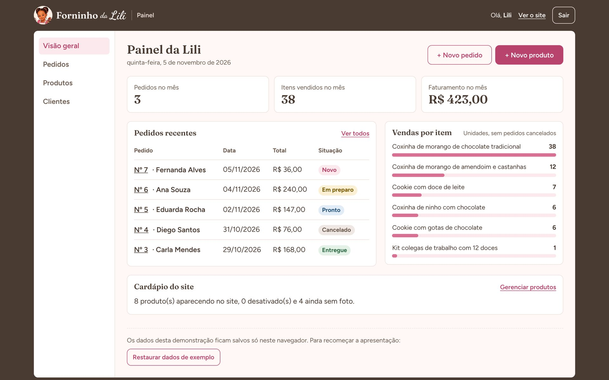
</p>

<details>
<summary><b>Ver mais telas do painel</b></summary>
<br>

| Login | Produtos |
|---|---|
| 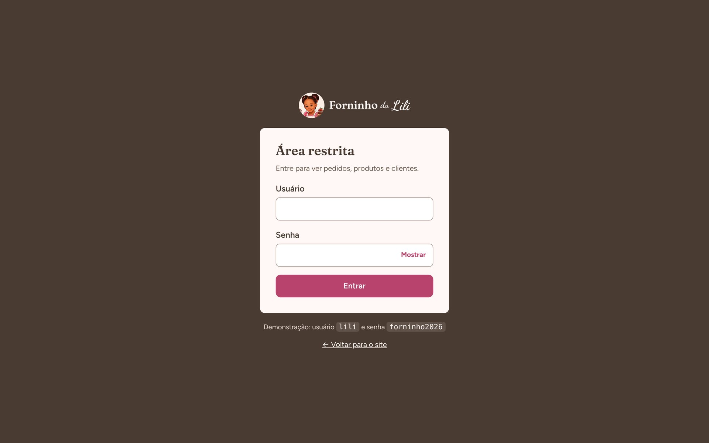 | 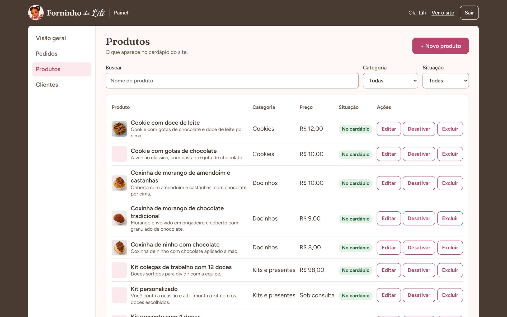 |
| **Novo produto** | **Pedido com vários itens** |
| 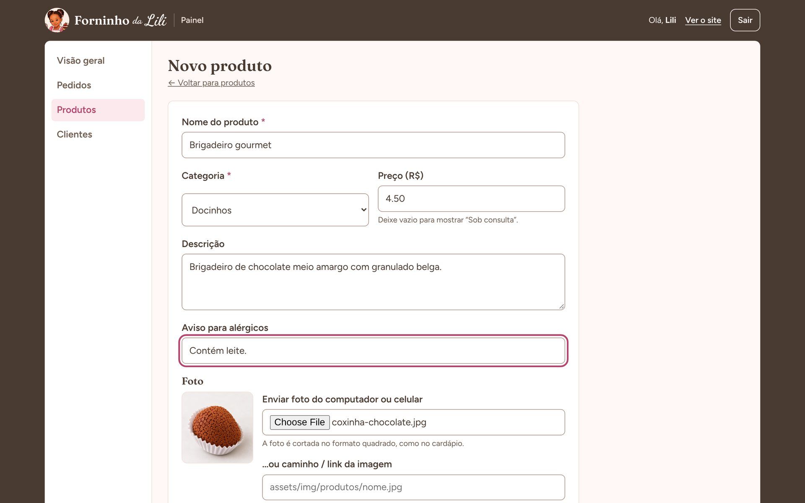 | 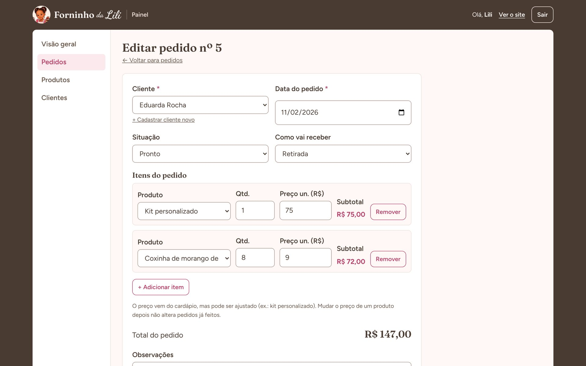 |
| **Pedidos** | **Clientes** |
| 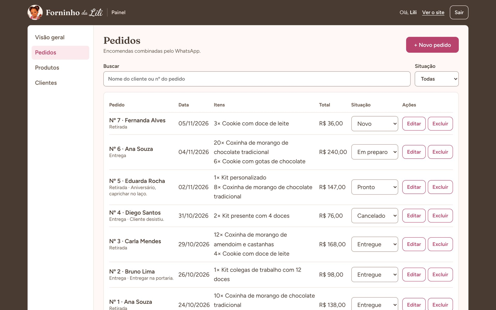 | 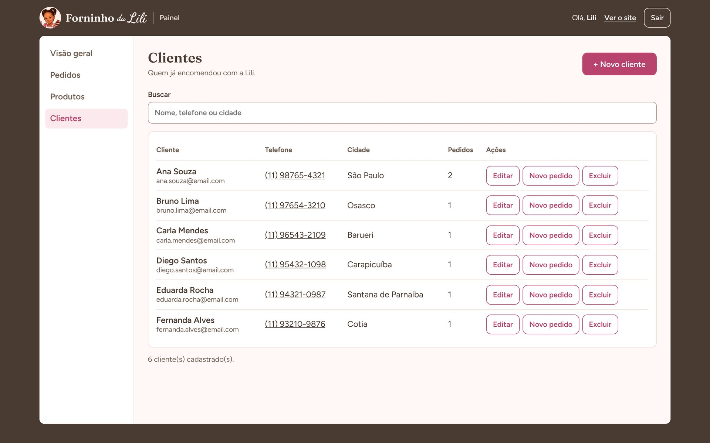 |

</details>

## 🧠 Decisões de projeto

Duas perguntas guiaram o painel: *como a Lili adiciona um doce novo?* e *o que acontece quando ela para de fazer um doce?*

- **Doce novo sem programador.** Antes, cada produto era um bloco copiado à mão no HTML. Agora é um formulário: nome, preço, foto, salvar.
- **Desativar em vez de excluir.** Um doce desativado sai do cardápio, mas continua nos pedidos antigos e pode voltar depois (ideal para doces de Páscoa e Natal).
- **Exclusão protegida.** Produtos e clientes que já têm pedidos não podem ser apagados, para não perder o histórico de vendas.
- **Preço guardado na venda.** Cada pedido registra o preço do dia. Se o preço mudar amanhã, o faturamento do mês passado continua certo.
- **Painel escondido.** Sem link no site e com `noindex`, para não aparecer em buscadores.

<p align="center">
  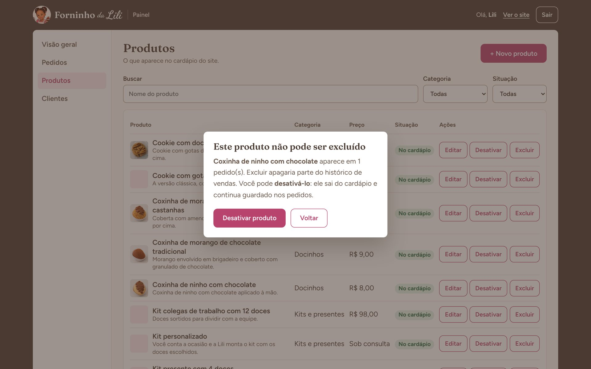
</p>

## 🗂️ Estrutura

```
forninho-da-lili/
├── index.html · cardapio.html · sobre.html · contato.html · 404.html
├── assets/
│   ├── css/estilo.css        # visual do site
│   ├── fontes/               # Fraunces, Figtree e Dancing Script
│   ├── img/                  # logo, vitrine e fotos dos produtos
│   └── js/
│       ├── dados.js          # camada de dados (espelha as tabelas do SQLite)
│       └── cardapio.js       # monta o cardápio com os produtos ativos
├── admin/                    # painel (abre só por /admin)
│   ├── index.html            # login
│   ├── painel.html · produtos.html · pedidos.html · clientes.html
│   ├── produto-form.html · pedido-form.html · cliente-form.html
│   └── assets/               # admin.css e admin.js (proteção por login)
├── banco/
│   ├── 01_criar_tabelas.sql  # usuario, categoria, produto, cliente, pedido, pedido_item
│   └── 02_dados_exemplo.sql
├── docs/                     # prints e documentação do projeto
└── Dockerfile                # PHP 8.2 + Apache + SQLite
```

## 🚀 Como rodar

Use um servidor local, para o site e o painel compartilharem os mesmos dados.

**Com PHP** (o mesmo comando servirá a versão com banco):

```bash
git clone https://github.com/matheusaribeirodev/forninho-da-lili.git
cd forninho-da-lili
php -S localhost:8000
```

Ou abra a pasta no **VS Code** e use a extensão **Live Server**.

| Endereço | O que abre |
|---|---|
| `http://localhost:8000` | Site do cliente |
| `http://localhost:8000/admin` | Painel da Lili |

**Acesso de demonstração:** usuário `lili` · senha `forninho2026`

**Com Docker:**

```bash
docker build -t forninho-da-lili .
docker run -p 8080:80 forninho-da-lili
```

> [!TIP]
> Teste rápido: cadastre um doce no painel, abra o Cardápio e atualize a página. Ele já está lá. Desative e ele some.

## 🗄️ Banco de dados

O modelo já está pronto para SQLite em [`banco/01_criar_tabelas.sql`](banco/01_criar_tabelas.sql):

```
usuario        categoria ──┐
                           ▼
cliente ──► pedido ──► pedido_item ◄── produto
```

Hoje, a versão de demonstração guarda os dados no navegador (`localStorage`), usando os **mesmos nomes de tabelas e colunas** do SQL. Assim, a troca para PHP + SQLite não muda as telas.

## 🚧 Próximos passos

- [x] Dividir a landing page em páginas
- [x] Separar a área administrativa em `/admin` com login
- [x] CRUD de produtos, pedidos e clientes
- [x] Modelo do banco SQLite
- [ ] Integrar com **PHP + SQLite** (PDO, `password_hash` e sessões)
- [ ] Publicar no Render com os dados no servidor
- [ ] Carrinho: vários doces em uma única mensagem de WhatsApp
- [ ] Criar categorias pelo painel
- [ ] Fotos reais dos doces que ainda estão com "Foto em breve"

> [!IMPORTANT]
> Esta é uma **versão de demonstração**. O login roda no navegador e os dados ficam só no aparelho em que foram cadastrados. A segurança de verdade (senha com hash e sessão no servidor) entra com a integração PHP + SQLite.

## 👥 Equipe

Projeto desenvolvido no curso de **Análise e Desenvolvimento de Sistemas — SENAI**.

| Nome | GitHub |
|---|---|
| Matheus Augusto Ribeiro | [@matheusaribeirodev](https://github.com/matheusaribeirodev) |
| [Nome 2] | [@usuario] |
| [Nome 3] | [@usuario] |
| [Nome 4] | [@usuario] |

---

<p align="center">Feito com 💗 para o <b>Forninho da Lili</b>: adoçando a vida com amor!</p>
